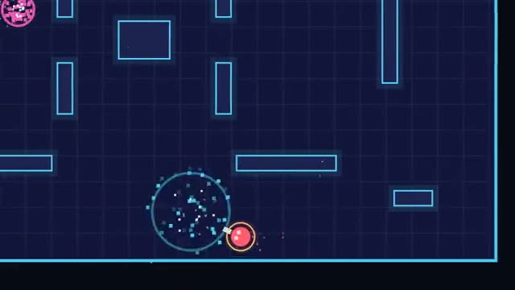

# Twin-Stick Arena

Top-down deathmatch. First to 10 wins. A multiplayer starter game from [Multiplayer Agent](https://multiplayeragent.com): 2D, versus, 2–8 players, with bots that fill empty seats.

## How it plays

Move with one stick and aim with the other. Walls block shots. You respawn three seconds after you go down. First to 10 kills wins, or the most kills when the clock runs out.

**Controls:** WASD and mouse, or two thumb sticks.

## Make it yours in the Game Builder

Open the [Game Builder](https://multiplayeragent.com), choose **Start from a starter game** and pick Twin-Stick Arena. It opens as version 1 in your studio, ready to play and publish. Then ask for changes, for example:

- Add a shotgun pickup in the center
- Split players into two teams
- Add a safe zone that shrinks

## Run it yourself

1. Get a free publishable key (`pk_…`) at [multiplayeragent.com](https://multiplayeragent.com).
2. In `index.html`, put it in place of `pk_REPLACE_ME` in the `MP_CONNECT` block.
3. Open `index.html` in a browser. No build step and no server needed.

Without a key it still runs, offline against bots.

## How it is built

- One `index.html`. The comment at the top of the script maps the code and explains the multiplayer.
- **Leaderboard:** The most kills each player got in one match.
- **Host-run rounds:** The host's browser keeps score, runs the clock and starts the next match; if it leaves, the next player takes over.
- **Bots:** Bots fill the arena until enough people join.
- **Live sync:** Every player and every bullet shows up for everyone at once.
- `?attract` runs it offline with bots only. The preview video is recorded from it.

## License

MIT.
